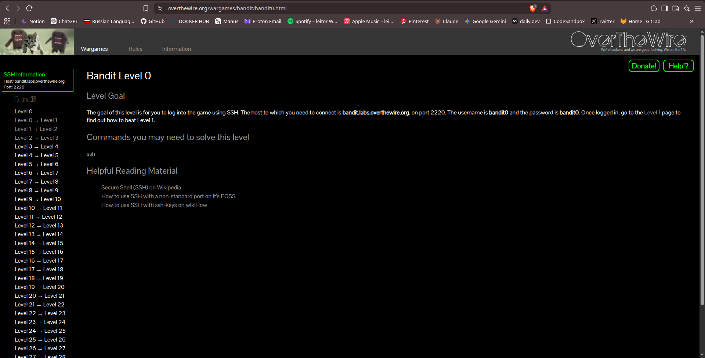
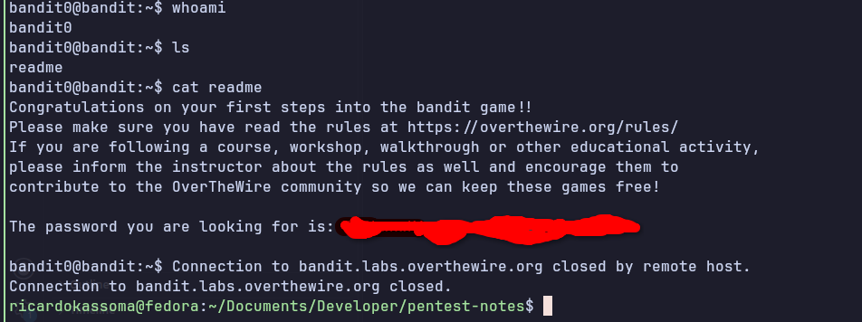

# Introduction

This is the introduction of Overthewire labs to pratice my skills.

## Challenge
[Bandit-Level 0](https://overthewire.org/wargames/bandit/bandit0.html)

That is starting point of the challenge provided by Overthewire community.

## How I signed in the ssh server?

### 1. Search how ssh works.
- I use the material that overthewire provide in their first module level.

- Then I see how to connect to a specific port that the challenge request, in that case they requered to connect to port 2220.

### 2. Sign in the ssh server

1. I analyse the information that was provided to me like, the host, port, user name and password.
2. I open my terminal and put the right credentials.

3. And find some secret file that containt a secret.

## 3. What I learn in that initial level of bandit?

Well, in that first level i have learned how to sign in the ssh server with some credentials and use them to enter and got the special secret that maybe will be important for my progress in this challange.